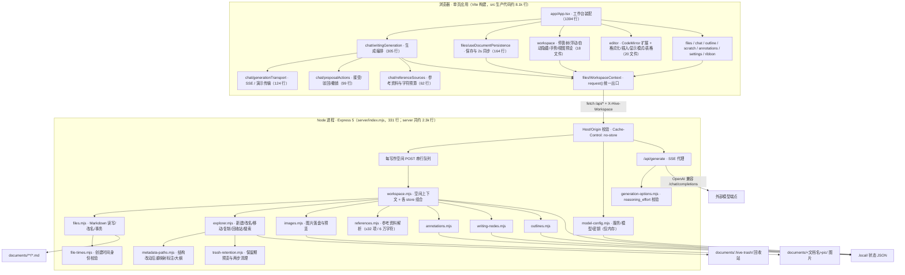
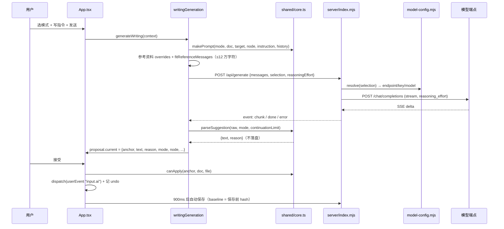

# 架构图（现状，2026-11-16 18:15）

> 只写现状，不写计划。改到分层、数据流、状态位置或不变量的改动，必须同一次更新本文件（见 `README.md` 的维护约定）。

## 1. 分层总览

## 2. 分层职责

| 层 | 位置 | 职责 | 不该做的事 |
| --- | --- | --- | --- |
| 入口 | `index.html` → `src/main.tsx` | 挂载 `<App />` | 不含任何业务逻辑 |
| 工作台 | `src/app/App.tsx` | 编辑会话表、面板装配、快捷键、对话框、标注粘合、视图快照 | 不写生成协议（在 `chat/writingGeneration`）、不写保存循环（在 `useDocumentPersistence`）、不写几何算法（在 `workspace`） |
| 生成编排 | `features/chat/writingGeneration.ts` | 组装上下文 → 调 `makePrompt` → 选传输 → 解析建议 → 写 `proposal` | 不碰 DOM 布局，不直接改正文（只产建议） |
| 传输 | `features/chat/generationTransport.ts` | 演示模式本地造文本；真实模式读 SSE、抛可读错误 | 不解释产品语义 |
| 建议动作 | `features/chat/proposalActions.ts` | `accept` / `reject` / `undoAI`，全部经 `canApply` | 不组装提示词 |
| 持久化 | `features/files/useDocumentPersistence.ts` | 900ms 自动保存、2s 磁盘同步、409 冲突记账 | 不决定编辑器内容 |
| 面板层 | `features/workspace/*` | 停靠树、浮动矩形、标签页、拖拽停靠、自动隐藏、图标轨道手势、面板锁手势、视图预设、面板目录/搜索 | 不认识「文档/标注」等业务语义（面板 id 由 App 决定） |
| 编辑器能力层 | `features/editor/*.ts` | 纯函数：格式化、插入、显示模式、预览计划、查找替换、打字机、状态栏统计、表格控件、笔记属性、frontmatter | 不直接发请求、不持有磁盘状态 |
| 编辑器视图层 | `features/editor/Editor.tsx` | CodeMirror 实例、扩展装配（`makeState`）、上下文菜单与插入对话框的挂载点 | 不决定保存策略 |
| 功能层 | `features/{files,chat,outline,scratch,annotations,settings,ribbon}` | 每个面板的交互与本地状态 | 不直接拼 URL（统一走 `useFileWorkspace().request`） |
| 传输层 | `features/files/WorkspaceContext.tsx` | `request(path, init)` 前缀 `/api` 并注入 `X-Hive-Workspace`，`register()` 登记切换前拦截 | 不解释业务错误 |
| 服务层 | `server/index.mjs` | 路由、参数校验、SSE 代理、统一错误映射、POST 串行化 | 不直接碰文件系统细节（走 store） |
| 存储层 | `server/{files,workspace,explorer,images,references,annotations,writing-nodes,outlines,model-config,metadata-paths,trash-retention,file-times}.mjs` | 原子写、锁、revision/hash 冲突检测、路径重映射、保留期清理 | 不做 HTTP 语义 |

## 3. 面板清单

| 面板 id | 组件 | 说明 |
| --- | --- | --- |
| `files` | `features/files/FileExplorer.tsx` | 文档树：新建/改名/移动/复制/回收站/还原/在资源管理器显示/排序/过滤 |
| `conversation` | `features/chat/WritingDock.tsx` | 对话与生成：模式、指令、消息流、模型选择、推理强度 |
| `outline` | `features/outline/WritingOutlineV2.tsx` | 写作节点大纲（可绑标题、带描述） |
| `toc` | `features/outline/TableOfContentsPanel.tsx` | 只读标题目录，折叠与定位 |
| `scratch` | `features/scratch/ScratchPad.tsx` | 自由草稿（固定文件 `自由草稿.md`） |
| `annotations` | `features/annotations/AnnotationPanel.tsx` | 文本标注列表与批量送 AI |
| `basis` | `features/chat/InputBasisPanel.tsx` | 本轮会发给模型的内容摘要（可见即所发） |
| `search` | `features/editor/FindReplacePanel.tsx` | 查找替换（正则/整词/大小写） |
| `trash` | `features/files/TrashPanel.tsx` | 回收站：按保留期预览、两步清理、还原 |
| `editor`、`editor:<uuid>` | `features/editor/Editor.tsx` | 正文编辑区，可多开；`editor` 是主编辑区，永不被彻底移除 |

已知面板 id 的权威清单在 `features/workspace/viewPresets.ts:40`（保存视图时校验），新增面板必须同步。

## 4. 一次「按大纲节点完成」的生成时序

要点：**模型永远只产出建议文本**；写进正文必须经过 `canApply` 校验，失败即标 `stale` 并要求重新生成。

## 5. 状态存在哪里

| 内容 | 位置 | 说明 |
| --- | --- | --- |
| 用户 Markdown | `documents/**/*.md`（`HIVE_DOCUMENTS` 可改） | 只允许 `.md`，禁符号链接，单文件 ≤ 2 MB |
| 图片 | `documents/<文档名>pic/*` | 上传 ≤ 12 MB；文件名去非法字符后去重；预览只允许空间内相对路径 |
| 回收站 | `documents/.hive-trash/<uuid>` + 同名 `.json` | 删除即移入；还原按记录回原路径，冲突即拒绝 |
| 写作空间设置 | `.local/workspace.json` | `{root,autoSave,revision}`；非默认空间在 `.local/workspaces/<id>/` |
| 草稿 | 当前空间根下的 `自由草稿.md` | 旧版 `.local/scratch.md` 仅在目标缺失时迁移 |
| 标注 | `.local/text-annotations.json` | 键 `source:file`，含 `revision` + 文本 `fingerprint` |
| 写作节点 | `.local/writing-outline-nodes.json` | 按文件存 `revision/initialized/nodes` |
| 大纲备注 | `.local/writing-outlines.json` | 按文件存 `{headingKey: description}`（旧版遗留，无 revision） |
| 文件创建时间 | `.local/file-times.json` | 以 `dev/ino/birthtimeMs` 作为身份，原子替换后不冒充旧创建时间 |
| 模型配置 | `.local/model.json` | `schemaVersion: 2`；**API Key 只在内存**，`HIVE_API_KEY` 可种子注入 |
| 界面外观 | `localStorage: hive.appearance.v1` | `uiScale/textScale/editorSize/ribbonVisible/ribbonCollapsed` |
| 底栏项 | `localStorage: hive.editor-status.v2` | 旧 `v1` 自动迁移；项集合与计数口径见 `statusModel.ts` |
| 视图预设 | `localStorage: hive.views.v1:<workspaceId>` | 按写作空间隔离 |
| 文件排序 | `localStorage`（`explorerState.readOrder`） | 手动顺序 + 按名/按修改时间 |
| 参考资料 | `localStorage`（`referenceSources.readReferenceSources`） | 每个「空间 + 文档」各存一份来源列表 |
| 推理强度 | `localStorage`（`modelReasoning`，按服务/模型分键） | `default/low/medium/high/xhigh` |

## 6. 全局不变量（改代码时不要破）

1. **磁盘优先**：正文以磁盘为准；内存中未保存的修改通过 `baseline`（hash）保护，冲突时阻止覆盖而不是自动合并。
2. **建议不落盘**：`proposal` 只是内存态，接受后才 dispatch，且必须走 `canApply`。
3. **位置即语义**：标注与建议都用 `{from,to,original}` 锚定；正文变化后用 `mapAnchor` / `mapAnnotations` 迁移，重叠即失效。
4. **单窗口写者**：同一空间多窗口并发由 `revision` / `x-hive-workspace` 拦下，返回 409 而不是后写覆盖；POST 在服务端按空间串行。
5. **结构改动连元数据一起搬**：改名/移动/回收站必须在同一事务里 `remapMetadata`，否则标注与大纲会指向旧路径。
6. **本机限定**：`/api/*` 只接受 `127.0.0.1` / `localhost` 的 Host，跨源请求拒绝。
7. **只代理不代持**：服务端不存对话历史、不把密钥写盘；每次生成由前端携带完整 `messages`。
8. **图片只读空间内**：预览只接受相对路径，拒绝 `http(s):`、绝对路径与符号链接，响应带 `nosniff` 与 sandbox CSP。
9. **参考资料只读且计预算**：最多 32 项来源、合计 ≤ 6 万字符；超预算只截断并回传 `warnings`，不改原文件。
10. **清理要两步**：回收站按保留期 `preview` 出清单与 token，`purge` 必须带同一 token，未确认的记录不动。

